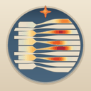
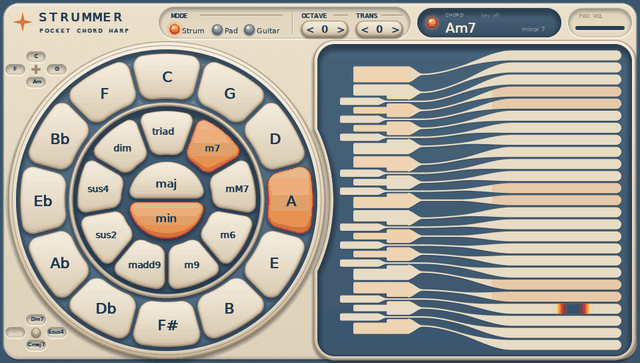
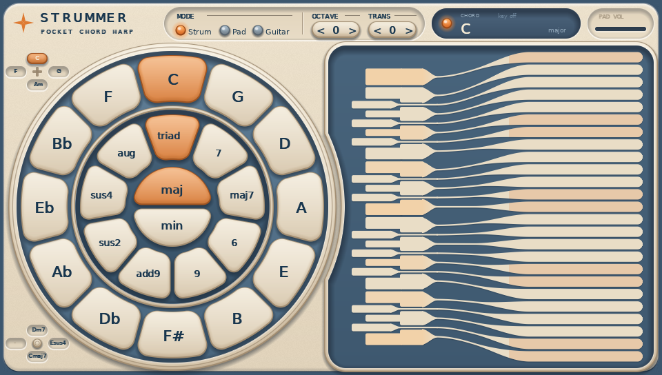
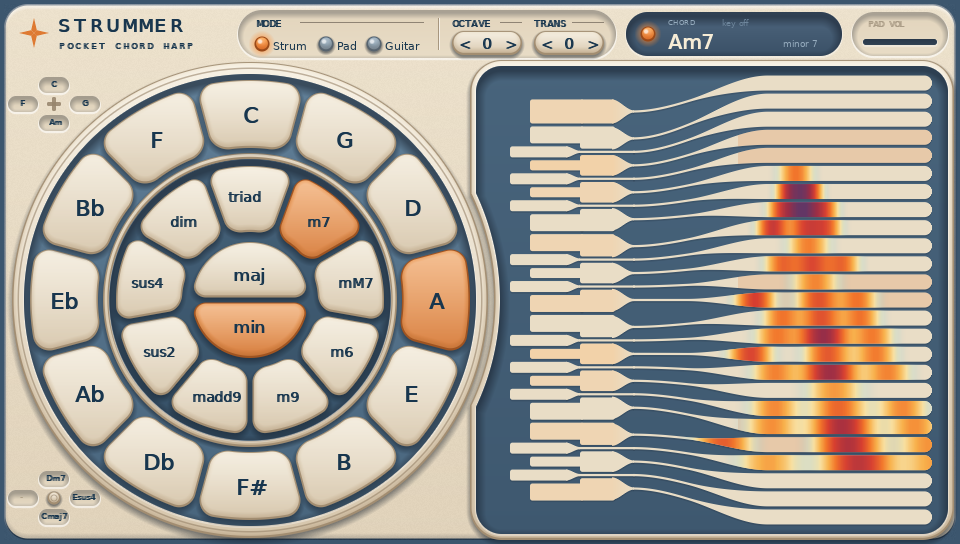
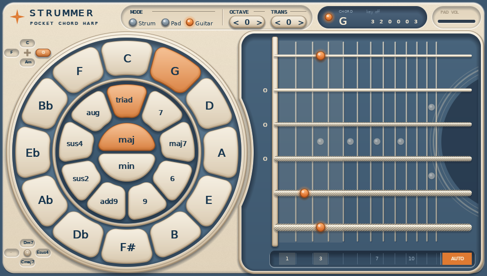
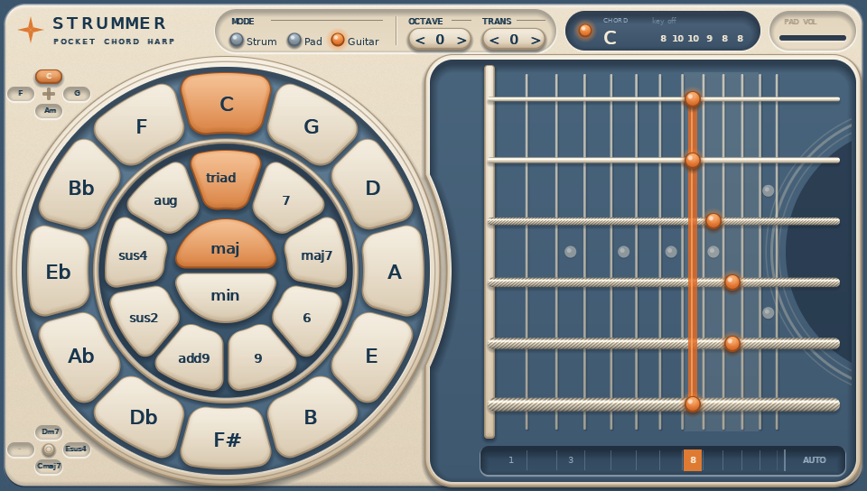
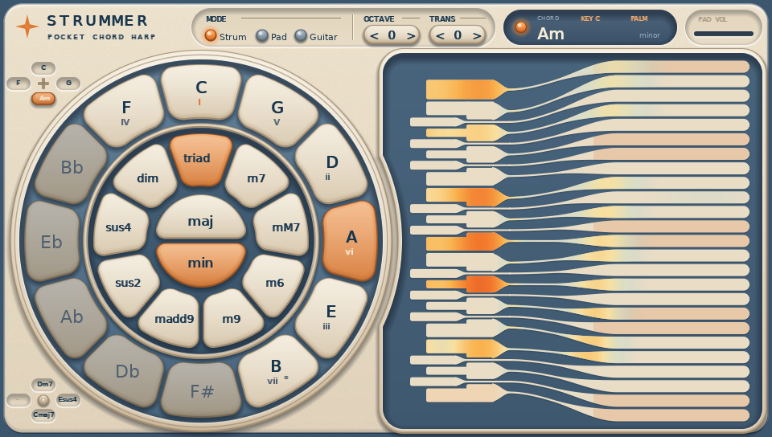
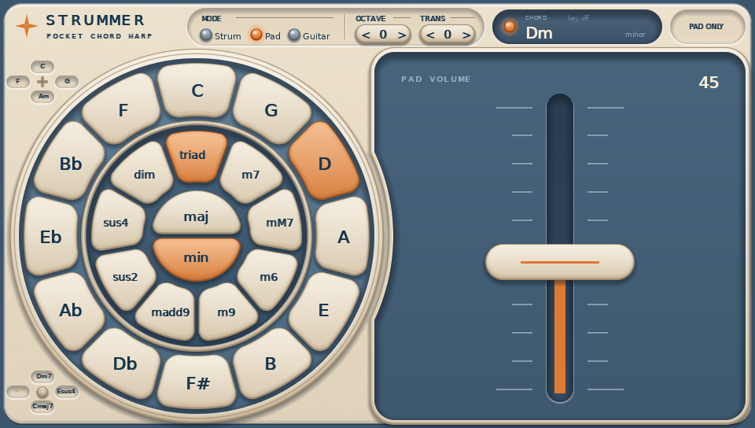

<p align="center">
  <br>
  <b>Vita Strummer</b><br>
  <i>An Omnichord-inspired chord strummer for PlayStation Vita</i>
</p>

<p align="center">
  <a href="https://github.com/Senty3kat/VitaStrummer/releases/latest"><b>⬇ Download the latest VPK</b></a>
  &nbsp;·&nbsp; <a href="#english">English</a> &nbsp;·&nbsp; <a href="#русский">Русский</a>
</p>

<p align="center"></p>

---

## English

Vita Strummer turns the PS Vita into a pocket chord harp. Pick a chord on the wheel with your left thumb,
strum the touch strings with your right hand — like an Omnichord, but with liquid light running
along every string you touch.

### Features

- **Chord wheel** — root on the outer ring (circle of fifths), major / minor in the center,
  9 modifiers on the inner ring: triad, 7, maj7, 6, 9, add9, sus2, sus4, aug / dim.
- **25 strings** that start as piano keys (C4–C6). With no chord they are chromatic; with a chord every
  pair of strings is the next chord tone up — more than four octaves of a triad.
- **Four modes**
  - **Strum** — the classic strummer.
  - **Pad** — the chord sustains while selected, strings play on top; pad volume knob for the balance.
  - **Pad only** — no strings, just the pad and a big volume fader.
  - **Guitar** — a 6-string neck with real chord shapes (open, E- and A-shape barre, C-shape),
    position strip under the neck, a plucked-string model with body and room. Every crossing of a string
    sounds, so tremolo picking works with a tiny finger motion.
- **Key mode** (Triangle) — scale degrees on the wheel, tapping a degree picks the right chord quality.
- **Quick chords** — 8 slots on the D-pad and left stick (START + direction saves, octave and guitar
  position included).
- **Rear touchpad** — right hand: palm mute, left hand: sustain.
- **Octave** (L / R) and **transpose** (−6…+6, like a capo on the guitar).
- **Settings** (tap the logo):
  - **MIDI IN / MIDI OUT over USB** — play your DAW from the Vita or play the Vita from your DAW.
  - **Wide sound** — 10 ms Haas delay on the right channel.
  - **Dreamy sound** — a soft kalimba / vibraphone / e-piano voice with tremolo and reverb.

### Screenshots

| Strum with a chord | Liquid light |
|---|---|
|  |  |
| **Guitar** | **Guitar, barre position** |
|  |  |
| **Key mode** | **Pad only** |
|  |  |

### Installation

1. You need a Vita (or PS TV) with **HENkaku / Ensō** and **VitaShell**.
2. Download `Strummer-vX.XX.vpk` from [Releases](https://github.com/Senty3kat/VitaStrummer/releases/latest).
3. Copy it to the Vita and install it with VitaShell.

### Controls

| Control | Action |
|---|---|
| Wheel, outer ring | Chord root (tap again to release the chord) |
| Wheel, center | Major (top) / minor (bottom) |
| Wheel, inner ring | Modifier |
| Circle | Release the chord (closes Settings when it is open) |
| Strings / keys | Tap — one string, swipe — every string you cross; multi-touch |
| L / R | Octave down / up |
| SELECT | Next mode: Strum → Pad → Pad only → Guitar |
| D-pad / left stick | Recall a quick chord |
| START + D-pad / stick | Save the current chord into that slot |
| START (short press) | Debug info |
| Triangle or tap the display | Key mode on / off |
| Rear touchpad, right half | Palm mute |
| Rear touchpad, left half | Sustain |
| Tap the logo | Settings |

While you play, the buttons in the top bar are locked for 0.7 s so you don't hit them by accident.

### MIDI over USB

Vita Strummer can work as a USB-MIDI device for Windows, macOS and Linux. No drivers are needed.

1. Install the kernel plugin `psvita_usb_audio_midi.skprx` from
   [VitaMIDI](https://github.com/Senty3kat/VitaMIDI): put it into `ur0:tai/` and add it under `*KERNEL`
   in `ur0:tai/config.txt`, then reboot.
2. In VitaShell turn off USB mode. Disable other USB plugins (`udcd_uvc`, `vitastick`).
3. Open Settings (tap the logo), tick **MIDI OUT** and/or **MIDI IN**, connect the cable.
   The status line shows *connected to computer*.
4. In your DAW the device is called **PS Vita USB**.

| What | Channel |
|---|---|
| Strum strings, guitar | 1 (note on/off, velocity) |
| Pad chord | 2 (held while it sounds; pad volume → velocity and CC7) |
| MIDI IN | notes from the computer play on the strings (chromatic mode for now) |

Want old hardware synths on 5-pin DIN? Use a USB-MIDI host box (CME H2MIDI, Kenton, Doremidi…)
between the Vita and the synth.

### Building

The VPK is built by GitHub Actions in the `vitasdk/vitasdk` container (`.github/workflows/build.yml`).
The USB-MIDI client from `third_party/psvita-usb-audio-midi` is built first and packed into the VPK.
Logic tests and screen previews run on plain Linux without vitasdk:

```
make -C host test          # tests, synth WAV demos, screen previews in host/out
python3 host/preview.py    # previews as PNG
```

### Credits

- Inspired by the Suzuki Omnichord.
- USB-MIDI: [psvita-usb-audio-midi](https://github.com/intermynd-instruments/psvita-usb-audio-midi)
  (MIT, DS-8 by intermynd instruments) with VitaMIDI changes.
- Built with [vitasdk](https://vitasdk.org) and vita2d.

---

## Русский

Vita Strummer превращает PS Vita в карманную аккордовую арфу. Левым пальцем выбираешь аккорд на колесе,
правой рукой проводишь по сенсорным струнам — как на Omnichord, только по каждой задетой струне
растекается «жидкий» свет.

### Возможности

- **Колесо аккордов** — тоника на внешнем кольце (квинтовый круг), мажор / минор в центре,
  9 модификаторов на внутреннем кольце: triad, 7, maj7, 6, 9, add9, sus2, sus4, aug / dim.
- **25 струн**, которые начинаются как фортепианные клавиши C4–C6. Без аккорда — хроматика; с аккордом
  каждая пара струн — следующий звук аккорда вверх, больше четырёх октав у трезвучия.
- **Четыре режима**
  - **Strum** — классический страммер.
  - **Pad** — аккорд звучит, пока выбран, сверху играют струны; ручка громкости пэда — баланс.
  - **Pad only** — без струн: только пэд и большой фейдер громкости.
  - **Guitar** — гриф с 6 струнами и настоящими аппликатурами (открытые, баррэ «ми» и «ля», форма «до»),
    полоска позиций под грифом, модель щипковой струны с корпусом и комнатой. Каждое пересечение струны
    звучит — тремоло получается маленьким движением пальца.
- **Тональность** (Треугольник) — ступени лада на колесе, касание ступени само ставит качество аккорда.
- **Быстрые аккорды** — 8 ячеек на D-pad и левом стике (START + направление — сохранить, вместе с октавой
  и позицией на грифе).
- **Задняя панель** — правая рука: palm mute, левая: сустейн.
- **Октава** (L / R) и **транспозиция** (−6…+6, у гитары — как каподастр).
- **Настройки** (касание логотипа):
  - **MIDI IN / MIDI OUT по USB** — играть с Vita в DAW или из DAW на Vita.
  - **Wide sound** — правый канал на 10 мс позже (эффект Хааса).
  - **Dreamy sound** — мягкий звук струн: калимба / вибрафон / электропиано с тремоло и ревером.

### Скриншоты

| Strum с аккордом | Жидкий свет |
|---|---|
|  |  |
| **Гитара** | **Гитара, баррэ** |
|  |  |
| **Тональность** | **Pad only** |
|  |  |

### Установка

1. Нужна Vita (или PS TV) с **HENkaku / Ensō** и **VitaShell**.
2. Скачай `Strummer-vX.XX.vpk` из [Releases](https://github.com/Senty3kat/VitaStrummer/releases/latest).
3. Скопируй на Vita и установи через VitaShell.

### Управление

| Что | Действие |
|---|---|
| Колесо, внешнее кольцо | Тоника (повторное касание — сброс аккорда) |
| Колесо, центр | Мажор (сверху) / минор (снизу) |
| Колесо, внутреннее кольцо | Модификатор |
| Круг | Сброс аккорда (или закрыть настройки) |
| Струны / клавиши | Касание — одна струна, проведение — все пересечённые; мультитач |
| L / R | Октава вниз / вверх |
| SELECT | Следующий режим: Strum → Pad → Pad only → Guitar |
| D-pad / левый стик | Вызвать быстрый аккорд |
| START + D-pad / стик | Сохранить текущий аккорд в эту ячейку |
| START (коротко) | Отладка |
| Треугольник или касание табло | Тональность вкл / выкл |
| Задняя панель, правая половина | Palm mute |
| Задняя панель, левая половина | Сустейн |
| Касание логотипа | Настройки |

Пока играешь, кнопки верхней полосы заблокированы на 0,7 с — чтобы не задеть случайно.

### MIDI по USB

Vita Strummer работает как USB-MIDI устройство для Windows, macOS и Linux, без драйверов.

1. Поставь kernel-плагин `psvita_usb_audio_midi.skprx` из [VitaMIDI](https://github.com/Senty3kat/VitaMIDI):
   положи в `ur0:tai/` и добавь под `*KERNEL` в `ur0:tai/config.txt`, перезагрузи Vita.
2. В VitaShell выключи USB-режим. Другие USB-плагины (`udcd_uvc`, `vitastick`) выключи.
3. Открой настройки (касание логотипа), включи **MIDI OUT** и/или **MIDI IN**, подключи кабель.
   В строке состояния — *connected to computer*.
4. В DAW устройство называется **PS Vita USB**.

| Что | Канал |
|---|---|
| Струны Strum, гитара | 1 (note on/off, сила удара) |
| Аккорд пэда | 2 (держится, пока звучит; громкость пэда → сила и CC7) |
| MIDI IN | ноты с компьютера звучат на струнах (пока в хроматике) |

Старые синтезаторы с DIN-5: между Vita и синтом нужен USB-MIDI хост-бокс (CME H2MIDI, Kenton, Doremidi…).

### Сборка

VPK собирает GitHub Actions в контейнере `vitasdk/vitasdk` (`.github/workflows/build.yml`).
Сначала собирается USB-MIDI клиент из `third_party/psvita-usb-audio-midi`, он кладётся в VPK.
Тесты логики и превью экрана работают на обычном Linux без vitasdk:

```
make -C host test          # тесты, WAV-демо синта, превью экрана в host/out
python3 host/preview.py    # превью в PNG
```

Подробное устройство кода — в [docs/DEVELOPMENT.md](docs/DEVELOPMENT.md).

### Благодарности

- Вдохновлено Suzuki Omnichord.
- USB-MIDI: [psvita-usb-audio-midi](https://github.com/intermynd-instruments/psvita-usb-audio-midi)
  (MIT, DS-8 от intermynd instruments) с правками VitaMIDI.
- Сделано на [vitasdk](https://vitasdk.org) и vita2d.
